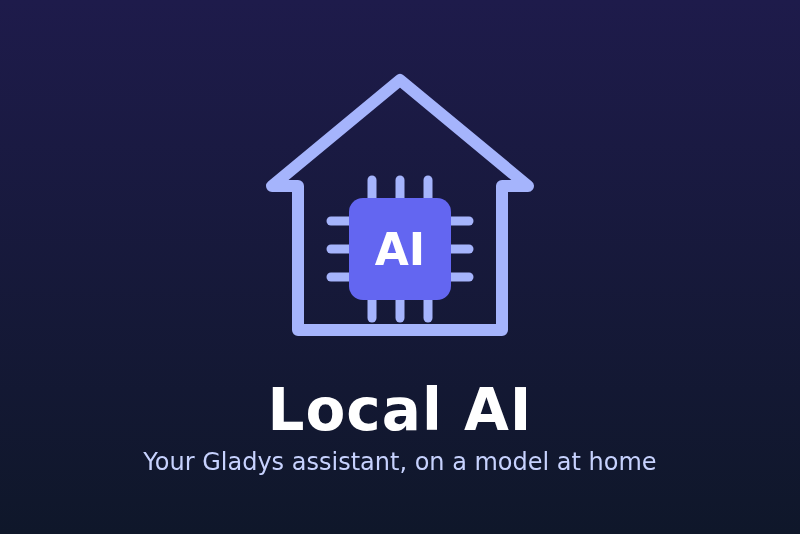

# Local AI for Gladys Assistant



An external integration for [Gladys Assistant](https://gladysassistant.com) 5.3 that runs the Gladys AI assistant on
a **model at home** instead of Gladys Plus: **Ollama**, or any server that speaks the OpenAI API — **LM Studio**,
**llama.cpp** `llama-server`, **LocalAI**, **vLLM**. Once selected in Settings → Artificial Intelligence, the chat and
its tool calls, the intent router, the scene `ai.ask` action and the weekly digest are answered by your model, and
the conversations do not leave your network.

Tested for real with Ollama 0.40.15 (CPU, `qwen2.5:1.5b` / `qwen2.5:0.5b`). LM Studio, llama.cpp, LocalAI and vLLM
are compatible through the OpenAI API but were not tested: feedback welcome.

## What it does

- **AI provider** (`type: "ai"`): one OpenAI chat completion in, one out; the agentic loop stays in the Gladys core.
- **Two models**: a chat model, and an optional small router model for `intent-classification` (Gladys gives it
  20 seconds; the integration gives up at 18).
- **Ollama, the right way**: Ollama's own OpenAI endpoint ignores `num_ctx` and `keep_alive` and runs every model
  with a 4096-token context, while a scene-creation request of Gladys reaches 10–15k tokens (Ollama then silently
  drops the start of the prompt). The integration recognizes Ollama and uses its native chat API with the context
  window and the keep-alive of the configuration, reads the capabilities of the model (`tools`, `vision`,
  `thinking`), refuses tools to a model that cannot call them with a clear error, turns images into a note for a
  model without vision, and keeps the router from thinking.
- **Supervision**: the connection status names the server, the models and the models in memory; actions to test the
  models and list them.
- **Scenes**: triggers when the assistant fails (kind filter) and when it answers again; actions to load a model in
  memory before you need it and to free the memory.
- **Dashboard widget**: server, models (in memory or not), memory taken, last answer time, current failure; load and
  unload buttons that a setting hides.
- **Quiet and private logs**: nothing of the conversations is logged, at any level (sizes and times only).

Not to be confused with [gladys-ollama](https://github.com/guim31/gladys-ollama), a `device` integration that exposes
an Ollama server as devices and scene actions; this one replaces the AI backend of the assistant.

## Requirements

- Gladys Assistant **5.3.0** or later.
- A model server reachable from the Gladys integrations network: Ollama on the Gladys machine listening on
  `172.30.0.1` (see the documentation), or any server of the local network.
- A model that **calls tools** (`qwen3:8b`, `llama3.1:8b`…). On a CPU, count tens of seconds per answer.

## Installation

In Gladys: **Integrations → Install from GitHub**, then `https://github.com/guim31/gladys-local-ai`. Type the chat
model, save, then select **Local AI** in **Settings → Artificial Intelligence**. The full guide, with the choice of
the model for your machine, is in the documentation: [English](docs/en.md), [français](docs/fr.md),
[Deutsch](docs/de.md), [español](docs/es.md).

## Limits

- Load and unload (scene actions, widget buttons) and the context window setting are Ollama-only; other servers set
  the context on their side.
- Small models create scenes poorly; an 8B model on a CPU is slow. The integration cannot make a model smarter.
- Ollama has no authentication: every Gladys integration can reach it on `172.30.0.1`.
- No streaming: Gladys asks for complete answers.

## Development

```bash
npm ci
npm run format:check && npm run lint && npm test
npx -y github:GladysAssistant/integration-store --skip-image-check .
```

The tests run against the fake Gladys of the SDK and a fake model server fed with real Ollama answers
(`test/fixtures/ollama.json`); they never touch the network.

## Credits

Built on the [Gladys integration template](https://github.com/GladysAssistant/integration-template-js) and SDK.
The OpenAI ↔ Ollama translation follows the [Ollama API documentation](https://github.com/ollama/ollama/blob/main/docs/api.md)
(MIT). Not affiliated with Ollama, LM Studio, llama.cpp, LocalAI, vLLM or OpenAI.

## License

[Apache-2.0](LICENSE).
